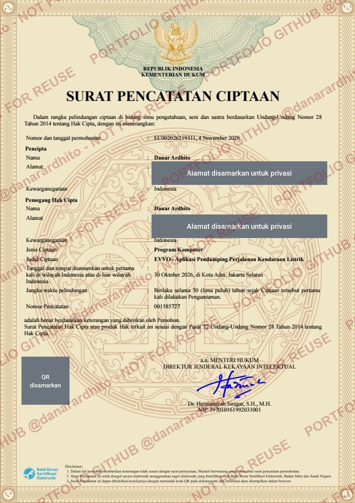

# EVVO — EV Route & Charging Companion for Indonesia

> **Showcase repository.** This repo presents what EVVO does and the engineering problems behind it.
> EVVO is proprietary software; the source code is private. © 2026 Danar Ardhito. All rights reserved — see [COPYRIGHT.md](COPYRIGHT.md).

EVVO helps electric-vehicle drivers in Indonesia plan trips with confidence: it estimates battery usage for local
driving conditions, recommends public charging stations (SPKLU) along the route, and shows places nearby to spend
the charging time. **EVVO Bisnis** extends the platform to fleet operators and merchants.

---

## The problem

- **Range anxiety on real Indonesian roads.** Official range figures come from mild-climate tests; tropical heat,
  constant air conditioning and stop-and-go traffic noticeably increase consumption.
- **Fragmented charging information.** Station details are spread across many sources, and practical details —
  such as which side of a toll road a rest-area charger is on — are rarely shown.
- **Idle charging time.** A fast charge still takes 30–60 minutes; drivers want to know what is within walking distance.

## What EVVO does

| For | Capability |
| --- | --- |
| Drivers | Route planning with a battery estimate tuned for tropical driving, charging stations along the route, navigation, station details, community reports |
| Fleet operators | Vehicle and driver management, live fleet tracking, trip history |
| Merchants | Promotions shown to drivers charging nearby, redemption at the cashier, performance summary |
| Operations team | Multi-role back office for data quality, moderation and automated data updates |

## Engineering highlights

- **Route-aware geospatial engine** — finds charging stations that are actually reachable along a route, not just
  near a point.
- **Energy estimation for local conditions** — conservative battery estimates that account for climate and traffic.
- **Automated data pipelines with guard rails** — scheduled updates with quality checks; bad or suspicious data is
  never published automatically and nothing is silently lost.
- **Safe concurrency** — booking and redemption flows designed so two users can never claim the same resource.
- **Security by design** — verified accounts, short-lived sessions, encrypted secrets, rate limiting and end-to-end TLS.
- **Open-data compliance** — attribution and licensing obligations of third-party data are built into the product.

## In numbers

- Native mobile app, cloud backend and two web portals
- 130+ API endpoints
- 200+ automated tests

## Copyright

EVVO is registered with the Directorate General of Intellectual Property (DJKI), Republic of Indonesia —
*Surat Pencatatan Ciptaan* No. **001585727**, work type: computer program.

  

Personal data on the certificate has been redacted for privacy.

## About this repository

This is a **portfolio showcase**, not an open-source project. No license is granted to use, copy or modify any
material here. More screenshots and engineering write-ups will be added over time.

**Author:** Danar Ardhito — [LinkedIn](https://www.linkedin.com/in/danar-ardhito-s-kom-m-t-i-6892ab43/)
