# EVVO — EV Route & Charging Companion for Indonesia

> **Showcase repository.** This repo presents what EVVO does and the engineering problems behind it.
> EVVO is proprietary software; the source code is private. © 2026 Danar Ardhito. All rights reserved — see [COPYRIGHT.md](COPYRIGHT.md).

EVVO helps electric-vehicle drivers in Indonesia plan trips with confidence: it estimates battery usage for local
driving conditions, recommends public charging stations (SPKLU) along the route, and shows places nearby to spend
the charging time. **EVVO Bisnis** extends the platform to fleet operators and merchants.

---

## The problem

- **Range anxiety on real Indonesian roads.** Official range figures come from mild-climate tests; tropical heat,
  constant air conditioning and stop-and-go traffic noticeably increase consumption.
- **Fragmented charging information.** Station details are spread across many sources, and practical details —
  such as which side of a toll road a rest-area charger is on — are rarely shown.
- **Idle charging time.** A fast charge still takes 30–60 minutes; drivers want to know what is within walking distance.

## What EVVO does

| For | Capability |
| --- | --- |
| Drivers | Route planning with a battery estimate tuned for tropical driving, automatic charging stops when the battery is low, weather impact on consumption, charging stations along the route, places to spend the charging time, navigation, community reports — try it without an account |
| Fleet operators | Vehicle and driver management, live fleet tracking, trip history |
| Merchants | Promotions shown to drivers charging nearby, redemption at the cashier, performance summary |
| Operations team | Multi-role back office for data quality, moderation and automated data updates |

## Screenshots — Drivers

### Try it without an account

<table>
  <tr>
    <td align="center" width="33%">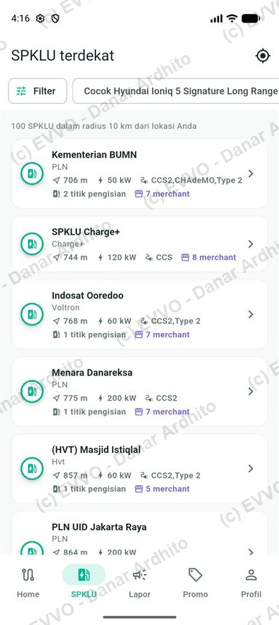 <b>Explore as a guest</b> Chargers around you, filtered for your car</td>
    <td align="center" width="33%">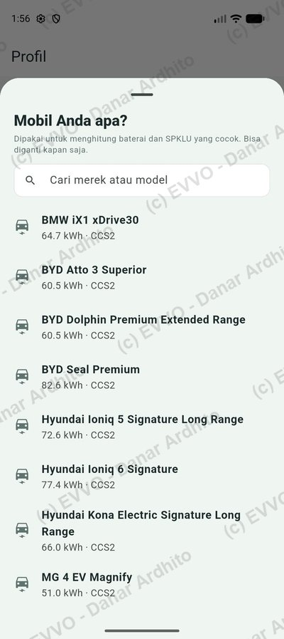 <b>Pick your EV</b> Estimates follow the selected model</td>
    <td align="center" width="33%">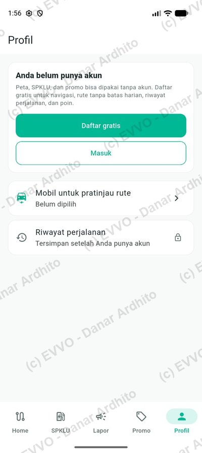 <b>Free account invitation</b> Unlock trip history and saved vehicles</td>
  </tr>
</table>

### Plan a trip

<table>
  <tr>
    <td align="center" width="25%">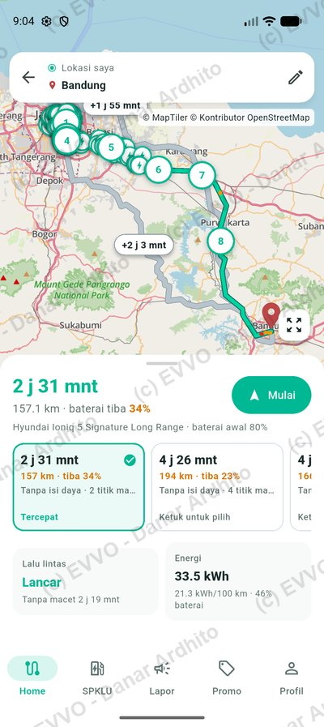 <b>Route plan</b> Jakarta → Bandung, arrival battery and alternatives</td>
    <td align="center" width="25%">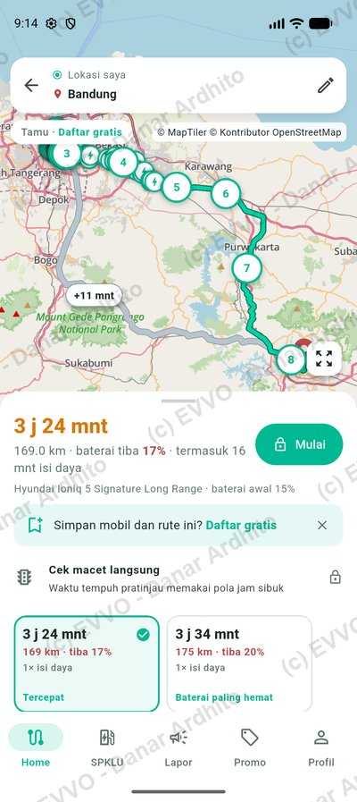 <b>Starting at 15%</b> The route automatically includes a charging stop</td>
    <td align="center" width="25%">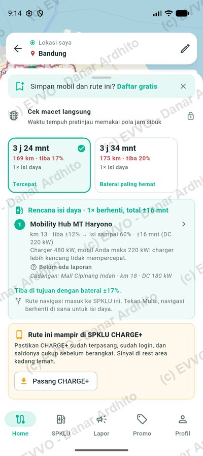 <b>Charging plan</b> Where to stop, how long to charge, and a backup</td>
    <td align="center" width="25%">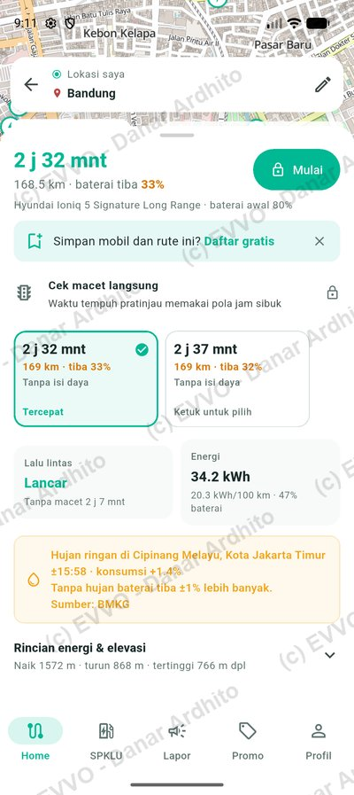 <b>Weather-aware</b> Rain on the route and its effect on battery</td>
  </tr>
</table>

### Drive and contribute

<table>
  <tr>
    <td align="center" width="25%">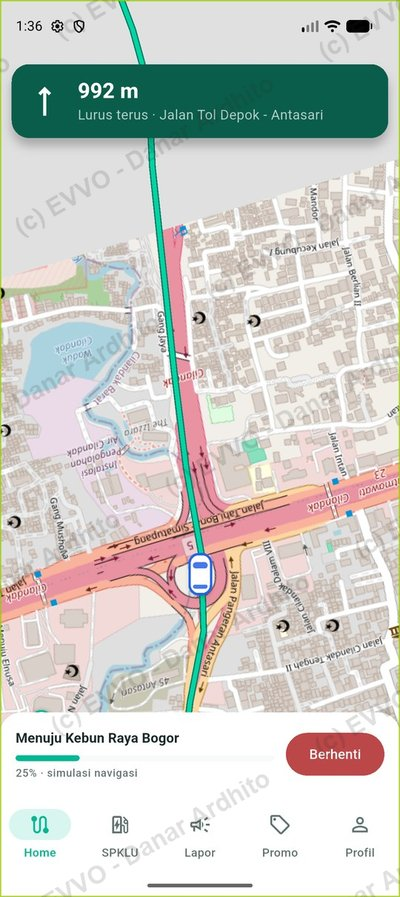 <b>Navigation</b> Turn-by-turn guidance on toll roads</td>
    <td align="center" width="25%">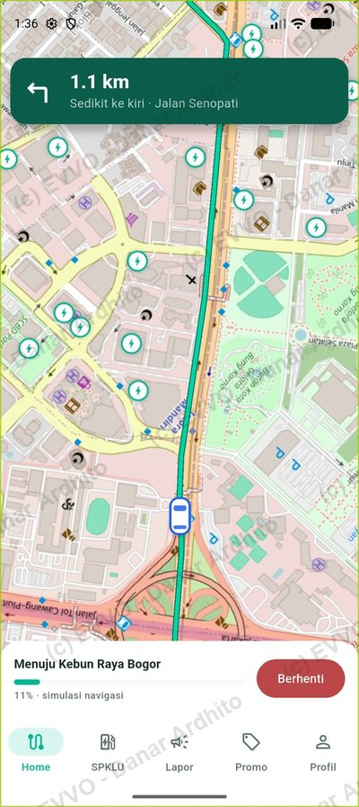 <b>City driving</b> Chargers stay visible on the map</td>
    <td align="center" width="25%">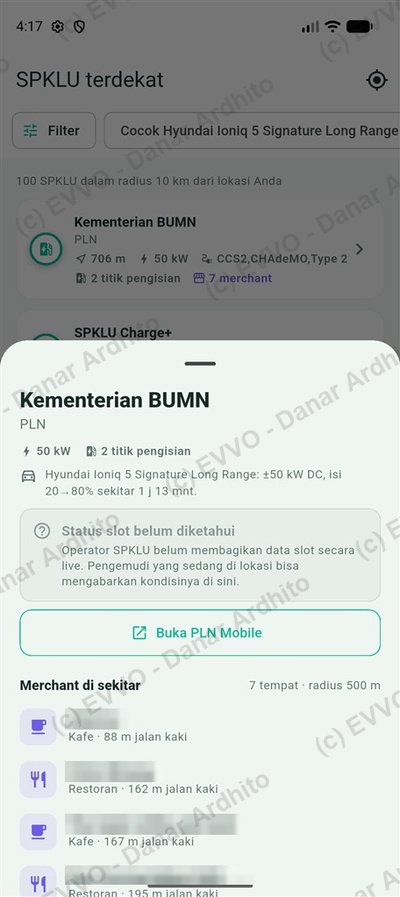 <b>While you charge</b> Cafés & restaurants nearby, with walking distance</td>
    <td align="center" width="25%">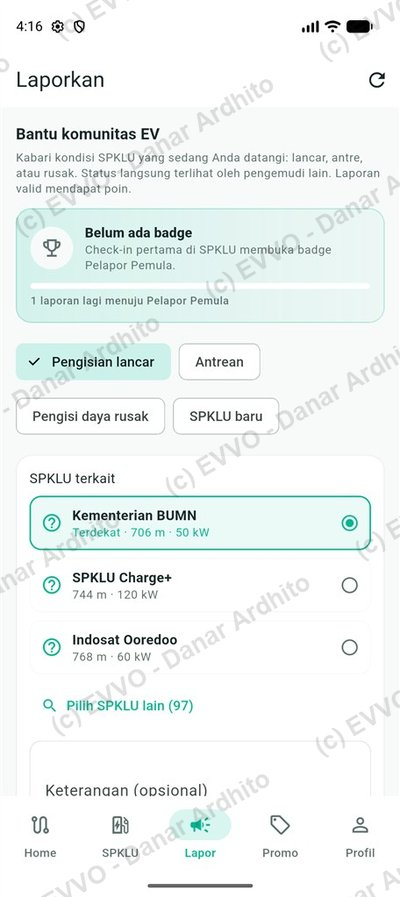 <b>Community reports</b> Drivers share live station conditions</td>
  </tr>
</table>

Android app. Names of nearby businesses are blurred. Map © MapTiler © OpenStreetMap contributors. Weather information from BMKG.

## Engineering highlights

- **Route-aware geospatial engine** — finds charging stations that are actually reachable along a route, not just
  near a point.
- **Energy estimation for local conditions** — conservative battery estimates that account for climate, traffic and
  rain forecast along the route.
- **Automatic charging-stop planning** — when the battery will not last, the trip is planned through a charging
  stop with arrival level, charging time and a backup station, and navigation is routed into it.
- **Places while you charge** — nearby cafés and restaurants with walking distance, so charging time is not idle time.
- **Automated data pipelines with guard rails** — scheduled updates with quality checks; bad or suspicious data is
  never published automatically and nothing is silently lost.
- **Safe concurrency** — booking and redemption flows designed so two users can never claim the same resource.
- **Security by design** — verified accounts, short-lived sessions, encrypted secrets, rate limiting and end-to-end TLS.
- **Open-data compliance** — attribution and licensing obligations of third-party data are built into the product.

## In numbers

- Native mobile app, cloud backend and two web portals
- 130+ API endpoints
- 200+ automated tests

## Copyright

EVVO is registered with the Directorate General of Intellectual Property (DJKI), Republic of Indonesia —
*Surat Pencatatan Ciptaan* No. **001585727**, work type: computer program.

  

Personal data on the certificate has been redacted for privacy.

## About this repository

This is a **portfolio showcase**, not an open-source project. No license is granted to use, copy or modify any
material here. More screenshots and engineering write-ups will be added over time.

**Author:** Danar Ardhito — [LinkedIn](https://www.linkedin.com/in/danar-ardhito-s-kom-m-t-i-6892ab43/)
